  

  
  
  

## Hi, I'm Nhat Long

I'm a developer. I build web products, systems and automation that stay reliable long after launch, and I share the work as it ships.

- **Web products:** fast, accessible interfaces that are easy to maintain and easy to grow.
- **Backend and integrations:** APIs, databases and the glue that makes separate tools behave like one system.
- **Automation:** repetitive manual work turned into workflows that run on their own.
- **Reliability:** tracking down bugs, slow pages and fragile deployments, then documenting the fix.

## What I work with

  
  
  
  
  
  
  
   
  
  
  
  
  
  
  

## Say hello

Follow the build on [X](https://x.com/1longg221), connect on [LinkedIn](https://www.linkedin.com/in/1longg/), or look around the [portfolio](https://1longg-dev.vercel.app).

Quiet code. Careful details. Software that simply works the day you need it.
